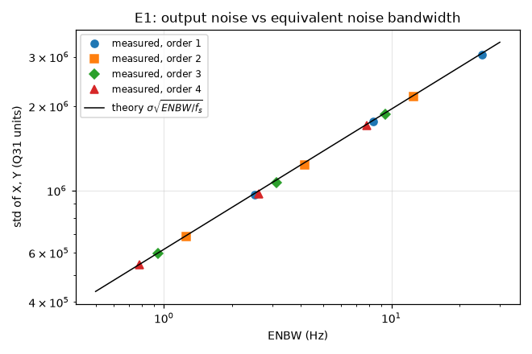
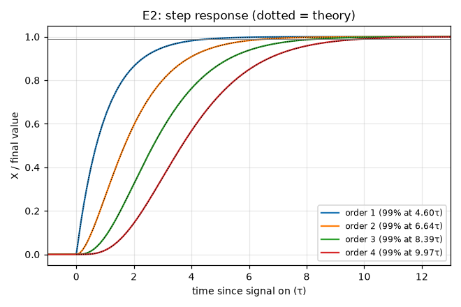
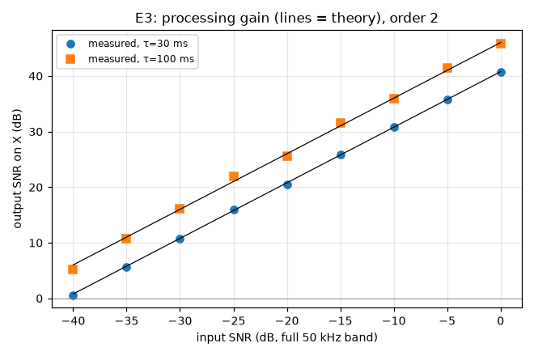
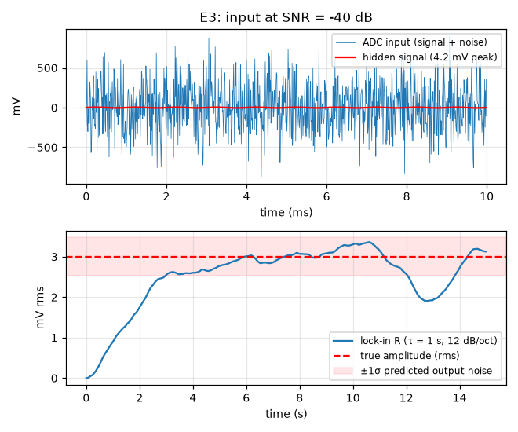
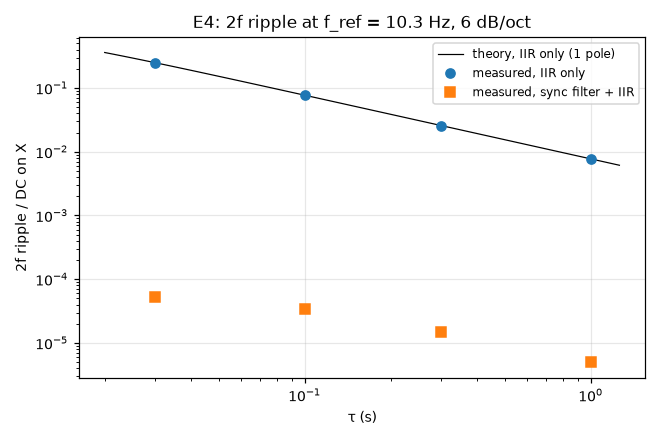
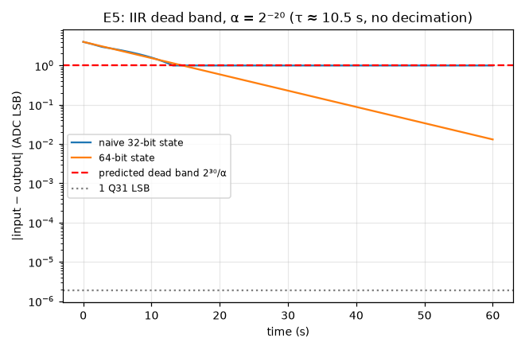
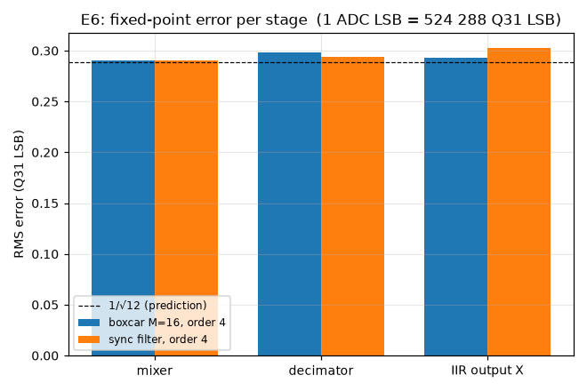
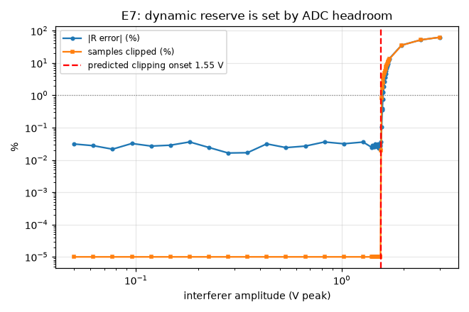
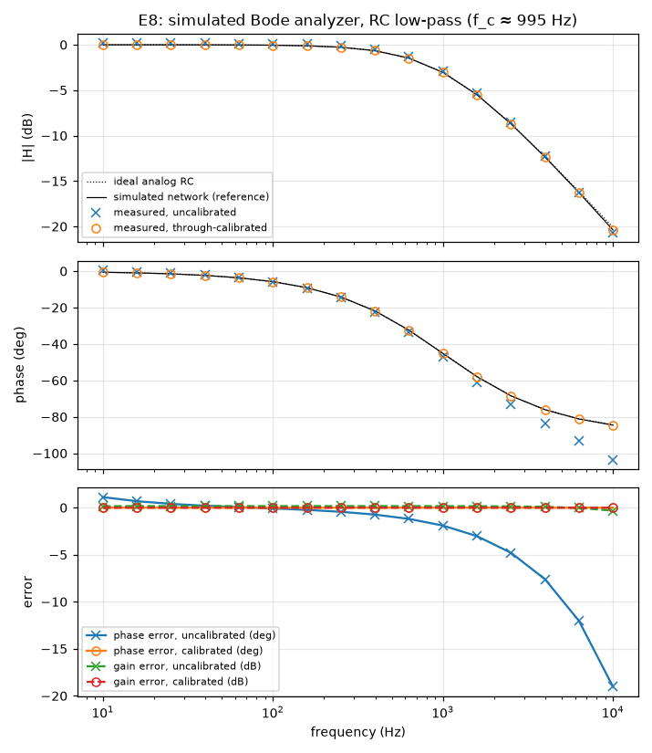

# Phase 0 — Simulation Results

Generated by `python -m experiments.run_all` (in `sim/`). Do not edit by hand.

**20 checks passed, 0 failed, 4 informational.**

| Exp | Check | Theory / prediction | Measured | Result |
|---|---|---|---|---|
| E1 | Output noise vs √ENBW (12 settings) | σ_X = σ_in·√(ENBW/f_s) | worst deviation 2.4% | pass |
| E2 | 99% settling, order 1 | 4.61 τ | 4.60 τ | pass |
| E2 | 99% settling, order 2 | 6.64 τ | 6.64 τ | pass |
| E2 | 99% settling, order 3 | 8.41 τ | 8.39 τ | pass |
| E2 | 99% settling, order 4 | 10.05 τ | 9.97 τ | pass |
| E3 | Processing gain, τ=30 ms, order 2 | 40.8 dB | 40.8 dB | pass |
| E3 | Processing gain, τ=100 ms, order 2 | 46.0 dB | 46.0 dB | pass |
| E3 | Signal recovered at -40 dB input SNR (τ = 1 s) | 3.000 ± 0.474 mV rms (1σ) | 2.477 mV rms (mean of last 3 s) | pass |
| E4 | 2f ripple, IIR only (4 τ values) | 1/√(1+(4πfτ)²) | worst deviation 0.0% | pass |
| E4 | Sync filter ripple reduction (worst case over τ) | large (non-integer period → not ∞) | ≥ 64 dB | pass |
| E5 | Naive IIR stall offset | ≤ 2³⁰/α = 524288 Q31 (1 ADC LSB) | 524287 Q31 (1.000 ADC LSB) | pass |
| E5 | Wide-state IIR error after 60 s (5.7τ) | target·(1−α)ⁿ = 6864 Q31 (below the dead band, still decaying) | 6864 Q31 LSB | pass |
| E5 | Same τ with decimation M=64 | α 64× larger → dead band 1/64 ADC LSB | (design note: decimating first also shrinks the dead band) | — |
| E6 | Q31 vs float, boxcar M=16, order 4: RMS error per stage | ≈ 0.29 LSB (1/√12) | mixer 0.29, decimator 0.30, IIR output X 0.29 LSB | pass |
| E6 | Q31 vs float, boxcar M=16, order 4: max error | ≤ 1 LSB | 0.75 Q31 LSB = 1.4e-06 ADC LSB | pass |
| E6 | Q31 vs float, sync filter, order 4: RMS error per stage | ≈ 0.29 LSB (1/√12) | mixer 0.29, decimator 0.29, IIR output X 0.30 LSB | pass |
| E6 | Q31 vs float, sync filter, order 4: max error | ≤ 1 LSB | 0.79 Q31 LSB = 1.5e-06 ADC LSB | pass |
| E7 | R error before clipping onset | ≈ 0 (interferer fully rejected) | max 0.036% | pass |
| E7 | Interferer amplitude where clipping starts | 1.55 V (A_sig + A_int = VREF/2) | 1.55 V | pass |
| E7 | Interferer amplitude where R error exceeds 1% | (above onset: mild clipping distorts R only slowly) | 1.59 V | — |
| E7 | Dynamic reserve for this signal | 20·log10(A_int,max / A_sig) | 24 dB  (no AFE gain: ≈ 0 dB relative to full scale) | — |
| E8 | Bode gain error, uncalibrated → calibrated (max) | → ≈ 0 | 0.316 dB → 0.0004 dB | pass |
| E8 | Bode phase error, uncalibrated → calibrated (max) | → ≈ 0 | 19.02° → 0.001° | pass |
| E8 | Bilinear warping of the simulated network at 10 kHz | simulation artefact | 0.29 dB vs ideal analog | — |

## Figures

### E1 — Output noise vs ENBW

### E2 — Step response / settling

### E3 — Processing gain

### E3 — Before / after at −40 dB input SNR

### E4 — 2f ripple and the sync filter

### E5 — IIR dead band

### E6 — Q31 vs float error

### E7 — Clipping and dynamic reserve

### E8 — Simulated Bode analyzer + through calibration

